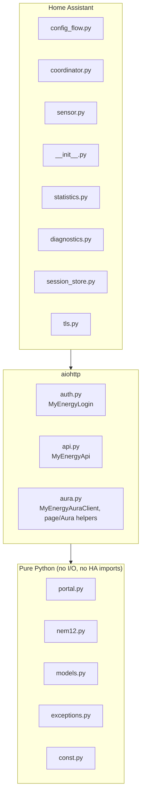
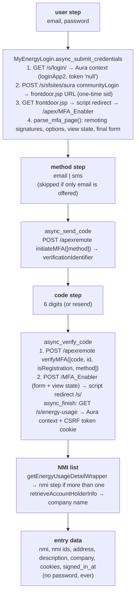
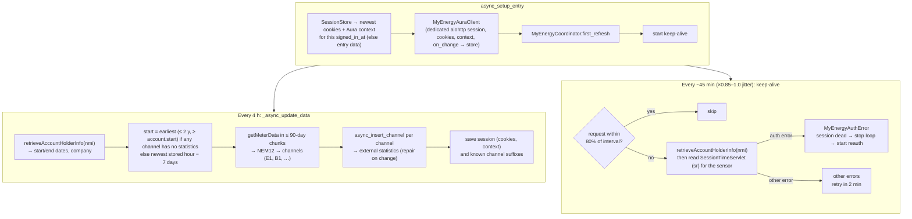

# Architecture

## Module layers

`tls.py` creates every HTTP session the integration uses (config flow and runtime).
The portal omits its TLS intermediate certificate, so the session's trust store is
certifi plus the DigiCert intermediate in `certs/`; see *TLS* in
`PORTAL_PROTOCOL.md`. Do not use `async_create_clientsession` for portal traffic.
Sessions share one connector (and so one SSL context) but have separate cookie jars.

The bottom layer has no I/O and no HA imports, and is fully unit-tested against
real (anonymised) portal responses.

## Sign-in (config flow)

Reauth runs the same steps. It aborts with `wrong_account` if the login can't
see the entry's NMI.

## Runtime

## Statistics

- One external statistic per NEM12 channel: `citipower_myenergy:<nmi>_<suffix>`,
  kWh, `has_sum`, no mean. Name: `<description> grid import|grid export`.
- 5-minute intervals are summed into hours in **AEST** (market time), and whole
  hours are the same boundaries in UTC.
- On every write, the stored window is compared with the portal's. From the
  first hour that differs (or is missing mid-history), everything is rewritten
  with the running sum recomputed from the hour before. This fixes estimates
  that are later replaced by actual readings.
- Hours that haven't finished yet are never written.

## Session persistence

`session_store.py` keeps `{entry_id: {signed_in_at, cookies, context, suffixes}}`
in `.storage/citipower_myenergy.session`. Cookies and context are used only if
`signed_in_at` matches the entry's. A reauth writes a new `signed_in_at`, so a
dead session is never resumed. `__Host-ERIC_*` (the CSRF token cookie) and
analytics cookies aren't stored. The token is re-read from the jar after each
page load.
