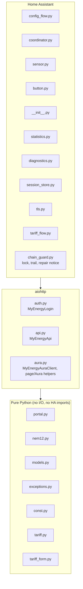
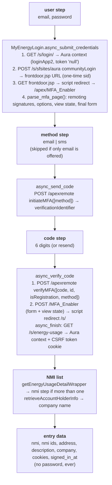
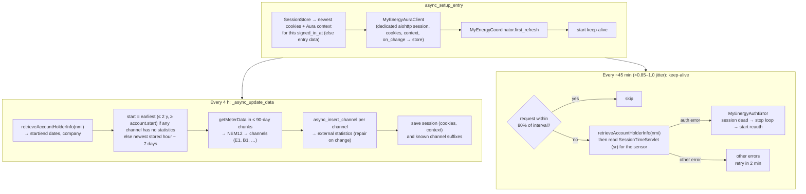
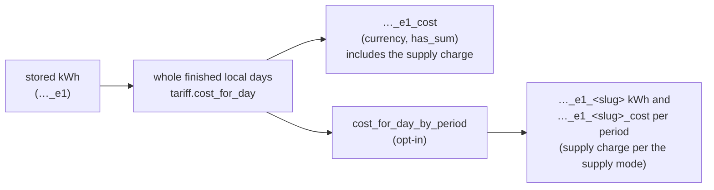

# Architecture

## Module layers

`tls.py` creates every HTTP session the integration uses (config flow and runtime).
The portal omits its TLS intermediate certificate, so the session's trust store is
certifi plus the DigiCert intermediate in `certs/`; see *TLS* in
`PORTAL_PROTOCOL.md`. Do not use `async_create_clientsession` for portal traffic.
Sessions share one connector (and so one SSL context) but have separate cookie jars.

The bottom layer has no I/O and no HA imports, and is fully unit-tested against
real (anonymised) portal responses.

## Sign-in (config flow)

Reauth runs the same steps. It aborts with `wrong_account` if the login can't
see the entry's NMI.

## Runtime

## Statistics

- One external statistic per NEM12 channel: `citipower_myenergy:<nmi>_<suffix>`,
  kWh, `has_sum`, no mean. Name: `<description> grid import|grid export`.
- 5-minute intervals are summed into hours in **AEST** (market time), and whole
  hours are the same boundaries in UTC.
- On every write, the stored window is compared with the portal's. From the
  first hour that differs (or is missing mid-history), everything is rewritten
  with the running sum recomputed from the hour before. This fixes estimates
  that are later replaced by actual readings.
- Hours that haven't finished yet are never written.
- **One writer at a time.** The poll and the options-flow recalculation both rewrite cost and
  per-period statistics, each chaining its first row from the stored total before it.
  `chain_guard.py` holds one `ChainGuard` per NMI (in `hass.data`, found with `guard_for`):
  every public write in `statistics.py` (`async_insert_channel`, `async_insert_cost`,
  `async_insert_period_statistics`, `async_recalculate_costs`) takes its lock for the whole
  run. It waits for the recorder (`async_block_till_done`) before reading, and after writing
  until the last row written can be read back (`_async_wait_until_stored`; the recorder's own
  `async_block_till_done` returns at once while it is part-way through the task it just took,
  which made the check after a write flaky in tests), so a starting total never predates
  queued rows. `reprice.py` is the recalculation shared by
  the options flow and the repair; the pure statistics functions need no setup in tests.
- **Join check.** A row *joins* when its running total is the previous row's total plus its
  own state. `_async_write_series` treats the first stored row of its window not joining the
  row just before the window (or two stored rows not joining) as a disagreement from that
  row's day and rewrites from there, so a bad join is healed even when every state is right.
- **Detector and trail.** After writing a statistic the rows are checked again from the first
  written row. A failure logs a warning (short label such as `e1_off_peak_cost` and the local
  hour, never the NMI) and raises one Repairs notice per entry (`repairs.py`: its fix reprices
  from far past, as the options flow's recalculation). A later passing check clears it. The
  guard also keeps the last 20 writes (who, statistic, repair-from day, supply mode, starting
  total, rows, whether a join was repaired, whether the check passed) for the diagnostics
  download. Only cost and per-period statistics raise the notice; a break in the combined kWh
  statistic is logged and kept in the trail. Everything stays local.

## Cost tracking

The portal carries no prices, so the user describes their tariff (options flow:
`tariff_flow.py`, with `tariff_form.py` building the text and form handling) and it is stored
in `entry.options["tariff"]` as `Tariff.to_dict()`. `tariff.py` is pure: a `Tariff` is a list
of versions by effective date; each has a supply charge, discount, GST flag and independent
import and export `Period` lists (windows in whole hours, per-day tiers). Windows and days
are read on the tariff's **pricing clock**, a version's `timezone`: Melbourne, Sydney, Hobart,
Canberra, Brisbane, Perth or GMT (only zones with whole-hour UTC offsets, because statistics are
hourly on UTC boundaries). No `timezone` means fixed AEST, the NEM clock and what v0.2.0b1/b2
did. A tariff has one clock for all its versions. `cost_for_day` prices one whole local day of
hourly kWh (23, 24 or 25 hours); the supply charge goes on the day's first hour, GST and the
discount apply to import only. NEM12 meter data is always parsed on AEST (`const.MARKET_TZ`).

- Costs are written a **whole finished day** at a time and repaired with the same rule as kWh:
  if a stored day's cost differs from what the tariff and readings now give, everything from
  that day on is rewritten with the running total recalculated. A re-run writes nothing.
  `async_recalculate_costs` reprices older history from the stored kWh.
- **Changing the clock** moves every window and day edge, so every stored cost disagrees from the
  first affected day and is rewritten. The options flow asks first and runs a recalculation from
  before any stored reading, using the new tariff, then saves. A rewrite ends at the last complete
  day on the new clock; an hour just beyond it that was priced on the old clock keeps its price
  but is re-chained (`_async_keep_the_tail`) so no running total points backwards, and the next
  complete day replaces it.
- **Per-period statistics** are optional (`period_statistics` option). Each import period gets
  a kWh and a cost statistic, so the Energy dashboard can draw each as its own coloured grid
  source. The period set is the union of all versions' period names, keyed by `period_slugs`;
  every statistic has a row for every hour (zero outside its period). All of them are repaired
  together, so they can never disagree. Home Assistant's fixed daily cost adjustment is not
  applied to per-period (time-of-use) sources, so where the supply charge appears is the user's
  choice, the `supply_in_periods` option (`const.SUPPLY_MODES`), read with `tariff.supply_mode_of`
  (absent or unknown means `none`) and passed to `cost_for_day_by_period(..., supply_mode)`:
  `none` (default) leaves it out of the period costs; `spread` adds `daily_supply_dollars` divided
  by the hours the local day really has (23, 24 or 25) to every hour; `first_hour` adds all of it to
  the day's first hour, the hour the combined cost carries it on. With the last two the periods
  add up to the combined cost for a whole day. A single-period (flat) version always behaves as
  `none`. The mode only changes cost rows; the options flow asks for it (and offers a
  recalculation, `async_recalculate_costs(..., supply_mode=)`) only for a time-of-use tariff with
  the per-period option on. Users must not also use the combined cost source alongside the period
  sources. Renamed or removed periods leave their old statistics behind, unwritten.
- Turning the option on backfills the whole stored history on the next poll.

### Live tariff sensors

Three sensors (`sensor.py`) follow the tariff's clock, so automations can react to the period
and act before an expensive one: **Current tariff period** (an enum of the period names, with
rates and the next period as attributes), **Current tariff rate** (`<currency>/kWh`, GST
included, before the discount) and **Next tariff period starts** (a timestamp). They exist only
when a valid tariff is saved, and they are not polled and never touch the recorder.

`tariff.py` supplies the pure lookups: `period_at` (the period at an aware moment, on the
tariff's clock, using the version in force that local day), `rate_at` (that period's headline
and discounted rate) and `next_period_change`. The last walks hour boundaries for at most
`SCAN_HOURS` (8 days) until the period's name or rates differ, so adjacent hours of one period,
including a stretch that crosses midnight, are a single stretch, and a version that only
changes the supply charge is not a change. `TariffTimeline` in `sensor.py` holds the answer as
of the last boundary and one `async_track_point_in_utc_time` timer for the next; each fire
recomputes, reschedules and rewrites the entities. When nothing changes within the scan (a flat
tariff, or the next version is further away) it looks again after `SCAN_HOURS - 24` hours so a
later version is still seen about a day before it starts. Saving the tariff reloads the entry
(the options listener), which rebuilds the timeline; unloading cancels the timer.

### Refresh data button

`button.py` has one button, **Refresh data**, that runs `coordinator.async_refresh()` now: the same
poll as the scheduled one (readings, cost, per-period statistics), so it takes the same NMI write
lock from `chain_guard.py` and writes nothing of its own. It exists for testing and as the retry
after a failed refresh, so it is **always available** while the entry is loaded (it overrides
`available`, which `CoordinatorEntity` would tie to the last poll succeeding). `async_refresh` keeps
a failure on the coordinator instead of raising, so after it the button raises `HomeAssistantError`
when `last_update_success` is false: an auth failure (the coordinator has already started the
reauth flow) says the session has ended and to sign in again, anything else says the poll failed
and why, with any URL query removed. A press while its own poll is still running is ignored (an
`asyncio.Lock` on the entity), so presses cannot start overlapping polls. A successful press
clears the session-dead state exactly as a scheduled poll does (`_touched`).

## Session persistence

`session_store.py` keeps `{entry_id: {signed_in_at, cookies, context, suffixes}}`
in `.storage/citipower_myenergy.session`. Cookies and context are used only if
`signed_in_at` matches the entry's. A reauth writes a new `signed_in_at`, so a
dead session is never resumed. `__Host-ERIC_*` (the CSRF token cookie) and
analytics cookies aren't stored. The token is re-read from the jar after each
page load.
